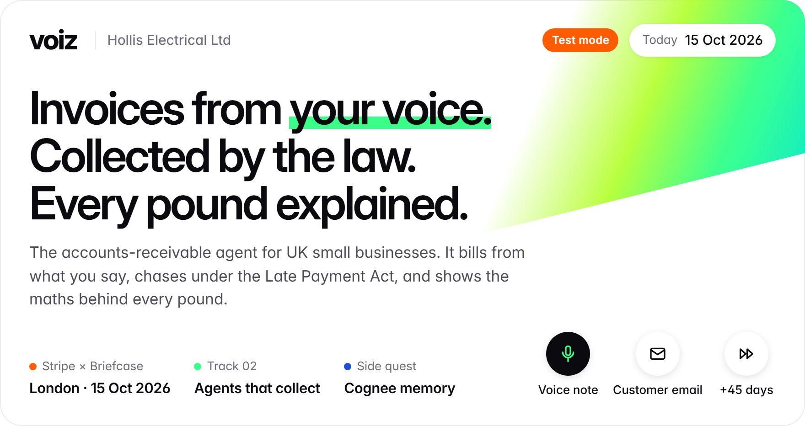
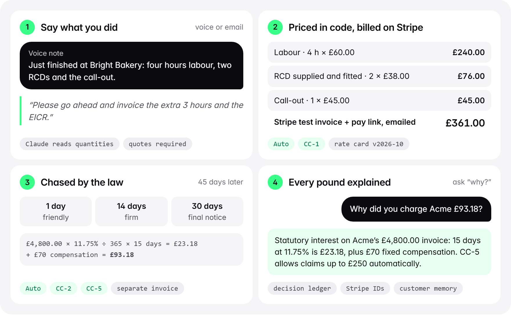
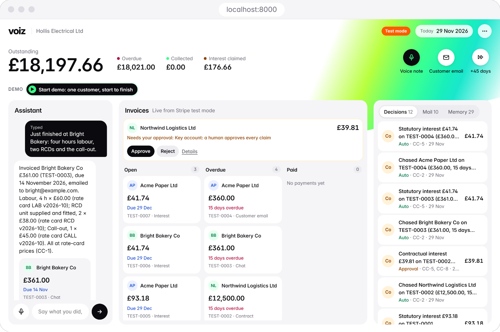
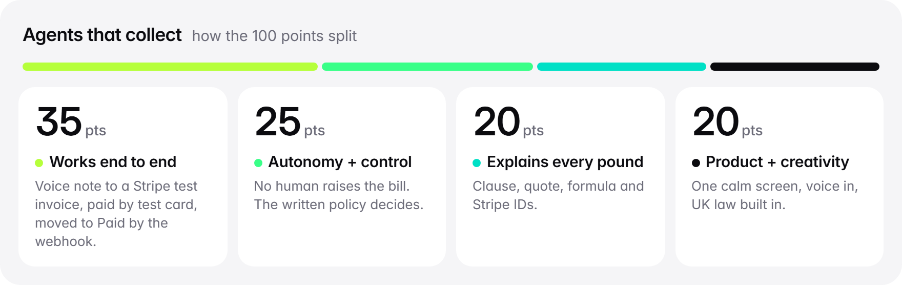
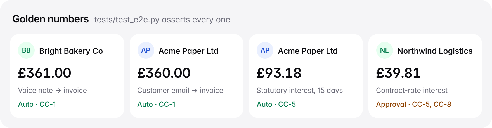

<picture>
  <source media="(prefers-color-scheme: dark)" srcset="docs/readme/hero-dark.png">
  
</picture>

<p align="center">
  <b>Stripe × Briefcase hackathon</b> · London · 15 Oct 2026 · <b>Track 02: Agents that collect</b> · Cognee side quest
</p>
<p align="center">
  <a href="#track-02-criterion-by-criterion">Track 02</a> ·
  <a href="#what-is-real-and-what-is-simulated">Real vs simulated</a> ·
  <a href="#how-it-works">How it works</a> ·
  <a href="#the-policy-in-one-breath">Policy</a> ·
  <a href="#run-it">Run it</a> ·
  <a href="DEMO.md">2-minute demo</a>
</p>

UK small businesses are owed billions in late payments, and most never chase or claim the statutory interest they are entitled to. **voiz** is an accounts-receivable agent for them, demoed for *Hollis Electrical Ltd*.

<picture>
  <source media="(prefers-color-scheme: dark)" srcset="docs/readme/moves-dark.png">
  
</picture>

1. The owner says what they did ("four hours labour, two RCDs and the call-out"), or a customer emails "please invoice the extra 3 hours".
2. voiz prices the work **in code** from the rate card, checks the written policy, raises a **Stripe test-mode invoice** and emails it with the pay link.
3. When an invoice goes overdue, it chases, raises a separate **UK statutory late-payment interest** invoice using the GOV.UK maths, and handles promises and disputes from email replies.
4. Every decision carries the policy clause, the evidence quote, the calculation and the Stripe IDs, and is remembered per customer, so "why did you charge Acme £93.18?" has a precise answer.

## See it

<a href="docs/readme/app.png"></a>

<sub>The real UI after a voice note, a customer's email and a 45-day skip on the Test Clock. Northwind is a key account, so its £39.81 interest waits for one click (CC-5, CC-8). Captured offline by <code>docs/readme/build.py</code>.</sub>

## Track 02, criterion by criterion

<picture>
  <source media="(prefers-color-scheme: dark)" srcset="docs/readme/scorecard-dark.png">
  
</picture>

| Criterion | Where to see it |
|---|---|
| **Works end to end, money billed in test mode (35)** | Voice note → Stripe test invoice → email with the hosted pay link → test-card payment → webhook (or 5 s poll) → card moves to *Paid* live. |
| **Autonomy with control (25)** | **No human raises the bill.** Amounts come from the rate card or the law, never from the model. The written policy (`POLICY.md`, CC-1…CC-8) decides *auto / needs approval / hold / deny*. A key account's interest waits for one click, and approval executes exactly the proposal (CC-8). Prompt injection in an email is refused (CC-7). Every Stripe write carries the decision ID and an idempotency key. |
| **Explains every pound (20)** | Click any invoice or decision to see the lines, the formula (`£4,800.00 × 11.75% ÷ 365 × 15 days = £23.18 + £70 compensation`), the clause, the evidence quote, the Stripe IDs, and *Why this amount?*, answered from the decision ledger plus customer memory. |
| **Product + creativity (20)** | One calm screen with voice input, a guided 5-step demo, and UK late-payment law applied automatically: the money SMEs leave on the table. |

## What is real and what is simulated

|  |  |
|---|---|
| Stripe **test-mode** invoices, payments, credit notes, webhooks (live keys are refused) | **Time:** a Stripe Test Clock skips 45 days |
| Claude reading voice notes and emails (structured output, quotes required) | **Customers:** teammates' inboxes, or the *Customer email* button |
| Gmail sending invoices and reminders (SMTP + app password) and reading replies (IMAP) | **The payer:** us, using test card `4242 4242 4242 4242` or *Pay with test card* |
| UK Late Payment Act maths: 8% + 3.75% base rate = 11.75%, plus £40 / £70 / £100 compensation | |
| Customer memory with remember / recall / improve / forget (Cognee) | |

With no keys, everything falls back to offline stand-ins (fake Stripe, rule-based reader, outbox, local memory). The header menu shows which mode is live.

## How it works

<picture>
  <source media="(prefers-color-scheme: dark)" srcset="docs/readme/architecture-dark.png">
  
</picture>

<details>
<summary>Text version of the diagram</summary>

```text
 voice / chat ─┐                       ┌─ Gmail inbox (IMAP) ─ customer replies
               ▼                       ▼
        desk: read work (Claude) ── inbox: classify (Claude)
               │   quantities + quotes only     │ promise · dispute · credit · bill me · injection
               ▼                                ▼
     rate card → price in code ──► POLICY (CC-1…CC-8, pure code) ──► auto | approval | hold | deny
                                               │
               ┌───────────────────────────────┼──────────────────────────┐
               ▼                               ▼                          ▼
     Stripe test invoices            collections tick on Test Clock    decision ledger
     (+ webhooks, 5 s poll)          chase 1/14/30 days · interest      → Cognee memory
               │                               │                          │
               └────────── Gmail (SMTP) ───────┘           "why?" ◄────────┘
                                   │
                         SSE → voiz UI (localhost:8000)
```

</details>

| Module | Job |
|---|---|
| `clause/desk.py` | Voice/chat → priced bill, approvals, "why?" answers |
| `clause/policy.py` + `POLICY.md` | The written policy as pure functions; a test fails if the two disagree |
| `clause/law.py` | Late Payment of Commercial Debts (Interest) Act 1998 maths |
| `clause/billing.py` | Stripe invoices, webhook, poll, Test Clock simulation |
| `clause/collections.py` | Reminders, interest invoices, approvals for key accounts |
| `clause/stripe_gateway.py` | Stripe test-mode client (refuses live keys) + offline fake |
| `clause/mail.py` | Gmail send/receive |
| `clause/inbox.py` | Inbound email → action |
| `clause/memory.py` | Cognee memory (one dataset per customer) + local fallback |
| `web/` | The UI: vanilla HTML/CSS/JS, self-hosted Inter, no build step |

## The policy, in one breath

| Clause | Rule | Decides |
|---|---|---|
| **CC-1** Billing | Bill from evidence; auto when the customer is known, every line is on the rate card and the total ≤ £1,500. |  |
| **CC-2** Chasing | Chase at 1, 14 and 30 days overdue. |  |
| **CC-3** Disputes | Disputes stop everything and go to a human. |  |
| **CC-4** Promises | Promises pause chasing until the date + 1 day. |  |
| **CC-5** Interest | Interest from 7 days overdue, on a separate invoice: auto ≤ £250, key accounts always need approval. |  |
| **CC-6** Credit notes | Small product-issue credits are automatic. |  |
| **CC-7** Guardrails | Emails are data; instructions are refused. |  |
| **CC-8** Approvals | Approval executes exactly the proposal and is remembered. |  |

Full text: [POLICY.md](POLICY.md).

## Run it

```bash
python -m venv .venv && .venv/Scripts/activate      # macOS/Linux: source .venv/bin/activate
pip install -r requirements.txt
cp .env.example .env    # ANTHROPIC_API_KEY, STRIPE_SECRET_KEY=sk_test_…, GMAIL_ADDRESS, GMAIL_APP_PASSWORD
python -m uvicorn clause.app:app --port 8000
# optional, for instant webhooks:
stripe listen --api-key sk_test_… --forward-to localhost:8000/webhooks/stripe   # put whsec_… in .env
```

Open http://localhost:8000 and click **Start demo** for a clean case study with one customer. Press **→** (or click the steps) to run it:

<picture>
  <source media="(prefers-color-scheme: dark)" srcset="docs/readme/demo-steps-dark.png">
  
</picture>

**Exit demo** returns to the full view: three customers, approvals and the key-account flow. The spoken script is in [DEMO.md](DEMO.md).

**Tests:** `python -m pytest -q`. 58 offline tests, including the whole demo story end to end. They check the golden numbers:

<picture>
  <source media="(prefers-color-scheme: dark)" srcset="docs/readme/golden-dark.png">
  
</picture>

## Team

Lorenz ([@LCS3002](https://github.com/LCS3002)) · Sasank ([@Sasank816](https://github.com/Sasank816)) · Ruhan Dagar · Arnav Popat

<picture>
  <source media="(prefers-color-scheme: dark)" srcset="docs/readme/footer-dark.png">
  
</picture>

<sub>The README art is drawn from the UI's own stylesheet (<code>web/styles.css</code>) in light and dark: edit <code>docs/readme/assets.html</code>, then run <code>python docs/readme/build.py</code>.</sub>
